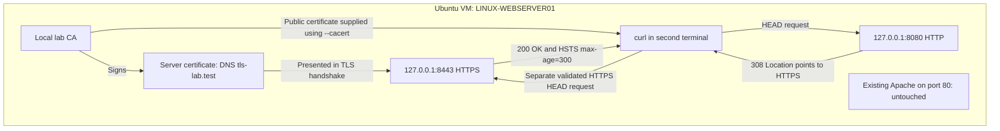

# Lab architecture

The two recorded curl requests were separate tests. The HTTP request did not automatically follow the redirect because `-L` was not used. `--resolve` mapped the test hostname to loopback for the HTTPS request while retaining that hostname for certificate verification.

The CA public certificate is used to establish trust for the command. The CA private key signs certificates and must remain private; it is not needed by the running web server. The server uses its own private key and certificate. No key is served through the HTTP handler.

## Scope of the ports

Ports 8080 and 8443 avoid interfering with the pre-existing Apache listener. Both listeners are local to this VM, not exposed on the VM's LAN interface. HSTS does not define a general 8080-to-8443 port mapping: an explicit HTTP port other than 80 is retained during HSTS upgrading. The script's fixed redirect supplies port 8443 explicitly. This arrangement therefore demonstrates header emission and a redirect, not a complete browser HSTS deployment. See [RFC 6797, section 8.3](https://www.rfc-editor.org/rfc/rfc6797.html#section-8.3).
