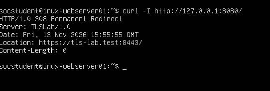
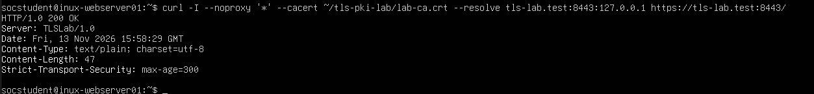
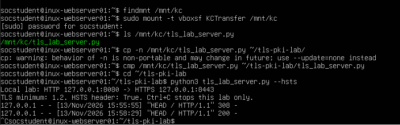
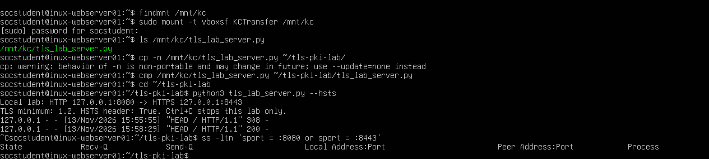

# Evidence and observed results

## Provenance

The four PNG files below are unedited screenshots supplied by Ryan Bryant during the November 13, 2026 exercise. They contain terminal commands and output from his Ubuntu VM. Dates shown by the server are preserved as displayed; no independent clock-validation test is claimed.

Earlier certificate-validation results are separate, summarized observations from the November 12 guided session. This package does not contain their original raw screenshots and does not manufacture output for them.

## 01: HTTP redirect



Command shown:

```bash
curl -I http://127.0.0.1:8080/
```

Visible output:

```text
HTTP/1.0 308 Permanent Redirect
Server: TLSLab/1.0
Date: Fri, 13 Nov 2026 15:55:55 GMT
Location: https://tls-lab.test:8443/
Content-Length: 0
```

**Finding:** The HTTP handler supplied the intended HTTPS destination. This command did not follow the redirect and did not validate a certificate.

## 02: HTTPS and HSTS



Command shown:

```bash
curl -I --noproxy '*' --cacert ~/tls-pki-lab/lab-ca.crt --resolve tls-lab.test:8443:127.0.0.1 https://tls-lab.test:8443/
```

Visible output:

```text
HTTP/1.0 200 OK
Server: TLSLab/1.0
Date: Fri, 13 Nov 2026 15:58:29 GMT
Content-Type: text/plain; charset=utf-8
Content-Length: 47
Strict-Transport-Security: max-age=300
```

**Finding:** This HTTPS request succeeded with explicit CA trust and normal hostname validation, without `--insecure`. The response contained the five-minute HSTS policy. Header presence does not prove that a browser stored or enforced the policy.

## 03: Server log and shutdown



The screenshot shows the file transfer check, server launch with `--hsts`, both HEAD requests, and a Ctrl+C followed by the shell prompt. Relevant log lines:

```text
Local lab: HTTP 127.0.0.1:8080 -> HTTPS 127.0.0.1:8443
TLS minimum: 1.2. HSTS header: True. Ctrl+C stops this lab only.
127.0.0.1 - - [13/Nov/2026 15:55:55] "HEAD / HTTP/1.1" 308 -
127.0.0.1 - - [13/Nov/2026 15:58:29] "HEAD / HTTP/1.1" 200 -
```

**Finding:** Server-side logs corroborate the status codes and request times. The returned prompt after Ctrl+C confirms this teaching-server process ended. The subsequent check is recorded below.

## 04: Post-stop listener check



Command shown:

```bash
ss -ltn 'sport = :8080 or sport = :8443'
```

**Finding:** The output contains the column header and no socket rows, followed by the shell prompt. Neither lab port was listening at the time of the check. This does not claim that unrelated services were stopped.

## Earlier observations: November 12

- CA private-key-derived public-key hash matched the CA certificate's public-key hash.
- Server certificate inspection showed `DNS:tls-lab.test` and the lab CA issuer.
- OpenSSL verification of the server certificate returned OK.
- An OpenSSL local TLS listener returned HTTP 200 for the matching hostname with the CA explicitly trusted.
- Without that CA trust, curl rejected the certificate with error 60.
- With the CA trusted but the hostname wrong, curl rejected the name with error 60.
- That OpenSSL listener was stopped before the Python demonstration.

These results illustrate separate trust and identity checks. They are not evidence of browser HSTS enforcement, replay prevention, MITM resistance under attack, or comprehensive TLS hardening.
